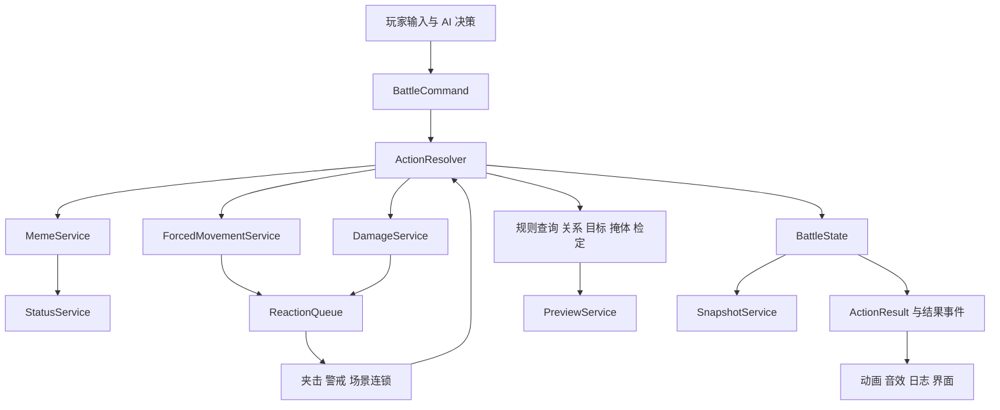

# 模因与战斗规则架构设计

本稿依据《模因词条列表》和《战斗系统（正式版）改进思路及功能设计》，结合当前项目代码，设计模因、战斗结算和相关战场机制的接入方式。文档提出的规则是需求资料；以下标为“建议”的内容是架构设计取舍，尚未替代现有玩法配置。本次只新增设计文档，不修改运行代码。

核心建议：保留现有 BattleManager 和各控制器作为接入层，逐步抽出统一行动结算流程。模因负责决定何时、对谁施加何种影响；状态系统负责影响的持续和解除；场景、夹击、指令通过有序反应队列参与同一行动。预览与实战使用同一套规则，表现只消费结算结果。

## 机制分析

模因系统是角色构筑机制。玩家通过成长、插件和配方获得词条，配置两个自由槽位，并在攻击或支援中自动触发。它比普通附加 Buff 多出类型适配、技能固有来源、行为改变、指定解除方式和恢复后的抗性。

战斗规则改造是一组空间与时序机制：场地破坏、击退碰撞、掩体、高低差、夹击、警戒、模式识别、伤害检定、预判和撤销。它们共用行动的目标、路径、命中结果和伤害来源，不能仅由各自脚本互相调用。

组合实例：角色击中机械敌人，模式识别成功，施加散热故障，再将敌人击退撞上油桶；油桶爆炸波及友军，敌人落入另一角色近战范围，触发夹击。这里需要解决状态何时施加、爆炸归属、死亡后是否继续夹击、重复触发和撤销恢复等问题。

玩法风险：

- 暴力和逆转敌我都可能被附近敌人的一次攻击解除。AI 若总能立刻解控，会把玩家的低概率触发收益压得过低。解控应占正常行动和资源，并受距离、视线与收益判断约束。
- 两个自由模因叠加技能固有和插件固有模因，再遇到多段/AOE，会明显增加触发次数。建议先按“每次行动、每个目标、每种模因最多一次”控制，而不是每段伤害各掷一次。
- 麻痹同时具备施加概率和行动取消概率，不等同于每次行动 30% 必取消；预览要分开显示。
- 细胞自毁按回合扣血，散热故障按行动扣血，对高速和多行动角色的强度不同，必须分别配置计时与触发频率。
- 30%/55%/85% 完全挡伤会产生很大的结果波动。界面应同时显示命中率、掩体挡伤率和命中后伤害区间，不能合成一个含义不清的“命中率”。
- 文档强调奖励和构筑，但未定义完整掉落/配方经济。架构预留奖励解锁接口，不自行补全配方成本和掉率。

## 现有代码与接入点

| 当前入口 | 已有能力 | 建议改造 |
|---|---|---|
| BattleManager.PieceSkill | 目标循环、状态、特殊效果、夹击、插件被动 | 转为 ActionResolver 的兼容入口，逐步停止直接嵌套施法 |
| DamageManager / DamageCalculator | 实战及只读直接伤害预览、4D6、屏障、聚能 | 保留计算资产，分离纯规则查询与提交伤害 |
| DiceCheckManager | 3D6 与模式识别分档 | 分离 CheckService 与骰子界面；命中后才做被动识别 |
| BuffManager / BuffState | 状态增减、来源、行动钩子、回合结算 | 分离持续时间、强度和来源；统一所有伤害通知 |
| SkillPack / BuffPack | 技能伤害、附加状态与特殊效果配置 | 增加稳定技能 ID、触发来源和模因引用，保留老字段适配 |
| ComponentConfig / ComponentEquipment | 插件属性、主动技能和攻击后被动 | 提供模因来源，不承担模因持续效果执行 |
| OrderManager | 扇形警戒与移动触发 | 路径事件驱动的 ReactionService，支持单体/AOE 技能 |
| CaverSlot / CheckCoverObstruction | 槽位吸附、掩体来源状态、遮挡查询 | 建立攻击方向相关的 CoverService，旧槽位逐步迁移 |
| EnemyController.Strategy / AIController | 仇恨及条件策略、AOE与爆炸物规划 | 统一关系查询、状态行为覆盖与解控行动评分 |
| BattleManager.SpeedTurns / SpeedTurnQueue | 速度条个人回合、标准时间轮 | 提供显式计时事件和可恢复时间线状态 |
| Player | 玩家属性、插件槽、deadCount | 增加模因装配 ID 与明确的休息周期受伤状态 |

当前 PieceSkill 在目标循环中启动击退 Tween，然后继续检查夹击，而碰撞扣血在 Tween.OnComplete 中执行。因此不能保证按最终落点做夹击，或保证碰撞和其他反应顺序。应优先解决这个结算入口问题。

当前随机来自 UnityEngine.Random 与 DamageCalculator 内部 System.Random。新增统一战斗随机源时，要连同插件和被动一起迁移，否则快照恢复仍不完整。

## 规则差异和建议默认值

| 问题 | 资料或代码情况 | 建议默认规则 |
|---|---|---|
| 掩体方案 | 前段为自动保护、四向闪避加成和减伤；后段为槽位象限及分级挡伤 | 主方案采用后段分级挡伤数值，同时用自动空间查询替代吸附；这是设计建议，需确认 |
| 多掩体 | 图示保护方向叠加，未定义概率叠加 | 有效保护方向取并集，同一攻击方向取最高等级，不连乘多次挡伤 |
| 中高掩体开火 | 资料要求向受保护方向不能开火 | 区分完全遮挡和可射击掩体；完整墙体禁止射线穿越，保护查询不能绕过视线规则 |
| 4D6 边界 | 文档遗漏结果恰等于 24 的归属 | 小于 6 为失败，6 至 24 为普通，大于 24 为大成功 |
| 伤害数值 | 文档失败为 70% 攻击力；代码为 20%；文档大成功为 1.3A-D，代码暴击/大成功不扣甲 | 新增版本化 DamageRuleProfile，不静默覆盖旧规则 |
| 3D6 边界 | 文档大成功要求大于 150%；代码大于等于 150% | 采用严格大于；使用整数比较 2×骰子和 > 3×对抗值 |
| 识别负面 | 文档“伤害减少40%”；代码实际乘 0.4 | 按文档为乘 0.6，作为规则版本差异记录 |
| 识别大成功 | 成功 130%，大成功必暴击；未写是否同时 130% | 建议大成功只强制暴击，避免额外叠加 130%；最终伤害顺序需确认 |
| 对抗属性 | 每两点模式识别增加 1 对抗；基础值未给出 | 基础对抗 + floor(有效模式识别/2)，敌我共用属性派生；不自动加到进攻骰值 |
| 支援触发模因 | 资料写支援也会自动释放，但现有已写词条几乎均为负面效果 | 必须由词条声明敌对/友好目标过滤；敌对模因不能对治疗对象自动生效 |
| 回合计时 | 资料多按阵营回合描述；项目已采用速度条个人回合 | 建议状态持续按目标个人回合结束递减；场景持续按标准时间轮，明确两者差异 |
| 回合中新增状态 | 可能在目标当前回合中施加 | 记录 AppliedTurnId，仅对回合开始时已有状态扣持续次数，避免新状态提前损耗 |
| 恢复后 50% 豁免 | 未写是永久抗性还是下一次 | 建议本场战斗持续、每次施加独立判定、不重复累加；战斗结束清除 |
| 受伤解除 | 暴力/逆转敌我受到任何伤害解除 | 建议实际生命损失 > 0 才解除；未命中、挡伤、屏障吸收不解除，DOT/碰撞可解除 |
| 受伤惩罚 | 上限降 35%，死亡三次退场；叠加方式不清 | 建议受伤上限固定为基础值 65%，不按死亡次数重复乘；休息清零周期死亡次数 |
| 传染等空词条 | 传染、精确误导、恶意节点、统御模因细则缺失 | 只建禁用占位配置，不自行创造效果 |

散热故障、逆转敌我的“检定成功必生效”需要明确使用哪项检定。建议配置 RecognitionPassed 前置条件；未进行识别的普通攻击不能自动视为成功。复制词条后普通攻击是否追加识别检定，是必须确定的玩法决策。

## 总体结构



图中的“结果事件”供表现和日志消费；“反应队列”负责规则执行。不要让 UI 订阅事件后再次扣血，也不要用动画完成回调决定规则是否发生。动画播放过程可以暂停行动执行，但中断动画不能丢失已经确定的结果。

不需要引入 ECS、外部事件框架或完整脚本语言。服务可先作为 BattleManager 持有的普通 C# 对象，沿用目前 DamageManager 的持有方式。

### 配置层

沿用项目现有配置习惯，建立集中 MemeCatalogSO、StatusCatalogSO、BattleRuleProfileSO。词条数量有限时，一个目录配置比每条生成多个 SO 更容易维护。所有引用使用稳定 ID，名称仅用于显示。

- MemeDefinition：ID、名称、目标标签、额外剧情目标筛选、触发事件、检定前置条件、触发概率、效果列表、触发频率、来源去重规则、解锁信息、是否启用。
- StatusDefinition：ID、标签、属性修饰、行为规则 ID、计时方式、叠加策略、解除条件、可用解除方式、恢复后抗性策略。
- BattleRuleProfile：伤害公式版本、掩体规则、高低差、夹击和碰撞策略、反应上限与优先级。
- SkillDefinition 增量：SkillId、固有 MemeIds、可触发的反应标签；AttackPack 继续保留现有伤害配置。

配置表达有限的组合条件，例如“目标具备 Mechanical 标签且 RecognitionPassed”。复杂行为如混乱目标选择、逆转敌我、屠龙术逃离，通过已注册的 C# 策略实现。不要为了几个行为设计任意表达式引擎。

### 运行状态层

建议逐步建立可复制的 BattleState，不一次性重写所有棋子。

```text
UnitState
  UnitId / OriginalFaction / BodyTags / 特殊剧情标签
  Position / Facing / ElevationTier / ActiveTurnId
  HP / MP / AP / 派生属性 / 装配槽位
  StatusInstances / ResistanceEntries / OrderState

StatusInstance
  InstanceId / DefinitionId / SourceUnitId / RootActionId
  RemainingTurns / StackCount / Magnitude / AppliedTurnId
  来源列表或来源令牌 / 行为附加数据

ActionContext
  ActionId / RootActionId / ParentActionId / ActorId
  ActionKind / SkillId / TargetIds / TriggerOrigin
  IsReaction / ReactionDepth / CheckedRecognitionByTarget
  HitResults / DamageResults / 随机样本记录
```

状态实例不要用 GameObject 或任意 object 作为唯一身份。长期需要稳定 ID，才能支持存档、撤销、对象池回收和重建。旧 BuffState.sources 可以先通过来源适配表接入，逐步替换。

### 长期进度层

队伍进度保存永久解锁的模因集合和配方；Player 保存两个自由槽位及休息周期受伤数据。插件提供的可装配权限与永久解锁分开：只有当前装备插件才能使用的词条，卸下插件后重新验证槽位；已永久解锁的词条保留。

战斗中换词条生成 EquipMemeCommand，校验解锁、重复装配、槽位数、活动单位和 AP，确认后原子地扣 2AP 并替换整套装配。取消菜单或校验失败不扣资源。技能/插件固有词条不占自由槽位，但同一模因多来源默认去重一次。

剧情与战斗共享 RerollResourceService。它负责每日初始三次及休息/奖励补充；CheckService 通过 CheckKind 判断可否重投。建议主动检定整组骰子重投一次、使用新结果，不能重投被动模式识别和暗骰伤害；文档没有明确单颗或整组，应作为待确认项。

## 行动结算顺序

1. Validate：校验当前行动权、状态权限、目标关系、距离、视线、资源。
2. CommitCost：确认后扣 AP/MP/弹药，分配 ActionId。预览和取消不提交。
3. BeforeAction：散热故障等行动前伤害、麻痹取消。建议散热故障先扣血，死亡或麻痹取消则不执行动作，已扣 AP 不返还；哪些行动参与由标签配置。
4. TargetResolve：固定并排序目标；每个目标分别命中检定，再做命中后的被动 3D6，按确定顺序判定掩体挡伤和护甲伤害。
5. DamageCommit：逐段提交伤害，立刻处理死亡及已有状态的受伤解除。记录 AppliedHpLoss，而不只记录请求伤害。
6. OnHitEffects：对存活且符合条件的目标做模因判定与附加状态。先处理旧状态解除再加新状态，避免新施加的混乱被本次命中立刻解除。
7. Displacement：查询击退路径、确定落点及第一碰撞事件，提交碰撞伤害和场景变化。
8. ReactionWindow：处理落点/路径对应的陷阱、警戒、夹击与场景连锁。处理前重新校验参与者存活和可行动性。
9. Finalize：反应队列排空后发布行动结束、检查胜负和更新时间线/预览。

每段位移可在穿越警戒边界时暂停，处理反应后重新判断移动者是否存活再继续。不能只在移动结束检查指令，否则会漏掉中途穿越区域。

反应使用同一个 ActionResolver，但标签限制触发能力。建议夹击不再生成夹击；警戒和夹击默认不再生成同类反应，是否允许触发模因单独配置。用 (RootActionId, ReactionType, ReactorId, TargetId) 去重，并设置深度/总事件数硬上限；达到上限应报诊断日志，不能依靠无限递归。

## 模因系统具体落地

MemeService 的职责是：合并角色自由装配、插件固有、技能固有来源，过滤目标，检查前置检定，判抗性，按固定概率判触发，然后提交效果。每次结果记录不生效原因：类型不匹配、前置失败、豁免、概率未触发。

“生物/机械”是目标能力标签，和阵营、伤害类型分开。信息节点增幅建议由 NetworkLinked 状态拓展目标可受影响的模因类别，保留原 BodyTags，不把机械身体改成人类。查询顺序：特殊剧情目标条件 → 身体类型或网络例外 → 抗性/免疫 → 触发门槛。

| 模因 | 配置 | 需要的运行行为 |
|---|---|---|
| 暴力 | 生物；15%；4目标回合；受伤解除；疫苗解除 | 混乱策略优先原阵营友军，允许场景目标；原阵营单位增加解控攻击评分 |
| 细胞自毁 | 生物；15%；5回合；最大生命10% DOT；移动-20%；疫苗/医疗解除 | 目标回合开始 DOT；命中降低幅度文档未给，不设默认数值 |
| 麻痹 | 生物；30%；4回合；疫苗/医疗解除 | 每次参与的主动行动30%取消，已扣 AP 不返还 |
| 散热故障 | 机械；检定成功；3回合；更新解除 | 行动前最大生命10%伤害；移除时登记本场50%概率抗性 |
| 逆转敌我 | 机械；检定成功；3回合；伤害/更新解除 | 攻击原阵营友军或支援对手；不转移棋子归属，不改变胜负统计 |
| 屠龙术1.0 | 黑衣人标签；15%；4回合；真实阴影解除 | 禁用所有进攻行动含夹击/警戒；逃离玩家威胁；移除后50%抗性 |

解除不是直接 RemoveBuff(id)。调用 TryRemoveStatus(reason, cureTags)，只有自然到期、死亡、符合解除条件或对应 CureTag 才成功。屠龙术不会被泛用净化解除；DEMO 可配置没有主动解除标签。

DOT、碰撞、爆炸、插件直伤必须通过统一 DamageCommit。否则“任意伤害解除状态”和击杀事件会在部分路径失效。

## 阵营与 AI

不能用修改 isPlayerPiece 实现逆转敌我。该字段同时承担输入归属、阵营判断和列表分组，改变它会影响操作权限、胜负、队伍 UI 和召唤归属。

建立 RelationshipService：

```text
CanTarget(actor, target, targetPolicy, actionContext)
CanAssist(actor, target, actionContext)
GetAttackCandidates(actor)
GetSupportCandidates(actor)
```

OriginalFaction 用于归属和胜负；行为状态影响攻击/支援关系。所有 SkillTargeting、AOE过滤、夹击伙伴、警戒、仇恨和 AI 规划逐步改用统一查询，不在每个系统再写混乱分支。

AI 先应用行为约束，再评分行动。屠龙术禁攻并使用逃离策略；逆转敌我重新生成攻击/支援候选；混乱允许原阵营友军与可破坏场景。清除友军异常的疫苗/更新作为正常技能候选，比较异常威胁、施法成本与伤害解控收益。

仇恨指向预览使用同一候选和评分函数，只读评估，不掷随机、不消费资源；它表示当前状态下的意图，状态改变后重新计算，不能承诺敌人的所有未来动作。

## 场景 击退 掩体和高低差

统一场景目标接口 ICombatTarget，为棋子和可破坏物提供稳定 ID、位置、存活/可用状态、受击响应和标签。无需强迫场景对象持有完整棋子属性。

SceneObjectDefinition 配置生命、碰撞标签、触发条件及效果序列。EffectHandler 支持伤害、区域状态、破坏、启用陷阱等少量操作。场景对象使用 Armed/Triggered/Destroyed 状态机防止连锁反复触发；RootActionId 保留造成连锁的原始行动来源。

ForcedMovementService 先查询再播放：路径同时检查 NavMesh 边界、物理障碍、动态棋子和可破坏物，返回最早阻挡点。当前 NavMesh.Raycast 可以复用，但不足以覆盖所有动态阻挡。预览和实战复用该查询；对受击半径留出安全偏移。

建议碰撞伤害 = floor(本目标本次直接攻击造成的实际生命损失总和 × 0.4)，只继承一次，不包含后续碰撞/爆炸/夹击。被击退者与撞到的棋子分别受一次伤害；可破坏物是否承伤由配置明确，默认承伤。碰撞伤害建议不再走4D6护甲，避免已经减免后的伤害二次扣甲。这些均需与策划确认。

CoverService.Query(attackerPosition, targetPosition, attackTags, elevation) 返回有效掩体、等级、挡伤率与是否阻断视线。近战跳过保护；有效攻击方向按资料的象限/180度范围定义。规则角度在世界战斗平面计算，不随等距摄像机画面转动。

高低差采用显式 ElevationTier，不从视觉 sprite 高度推断。攀爬成功才更新层级；高打低掩体降一级、低打高升一级，等级限制在0至3；高处远程暴击率乘1.5后封顶100%。完全阻断的墙体与掩体等级分开，不能因降级而穿墙。

## 预览与撤销

PreviewService 接受只读状态及候选 Command，调用同一规则查询，输出：命中率、挡伤率、直接伤害区间、模因触发条件与概率、击退终点、确定的碰撞和可夹击者。随机连锁只展示可能性，不能用抽一次样本伪装为预期。

要计算平均伤害，3D6/4D6 必须按实际骰子组合分布加权，骰子和不是均匀分布。第一版可以只给区间，不强制做完整概率树。

撤销分两级：

- 确认前取消：清掉计划与预览；资源和世界从未提交，不需要回滚。
- 已执行动作撤销：必须恢复动作前状态。若移动引发警戒、陷阱、拾取或随机事件，不能只把 Transform 移回去；建议第一版只允许没有不可见信息变化和反应的移动撤销。
- 每战两次回合撤销：建议对应当前可控角色个人回合开始快照，包含本角色行动引起的全部反应；若要回退一整个阵营轮次，需要额外定义速度条时间边界。

快照覆盖单位资源/坐标/存活/状态/抗性/模因槽位、速度队列进度/稳定排序/当前单位、场景对象、召唤和延迟技能、警戒、聚能、仇恨记录、战斗奖励暂存、随机源状态。快照只在反应队列为空且无表现锁的边界创建/恢复。

恢复时中止协程/Tween、清空待播表现和反应，重建对象、同步 NavMesh、重算派生属性与所有预览。死亡时不要不可逆地销毁可恢复对象。不可逆的跨场景剧情、成就上传和永久奖励放到战斗正式提交边界。

两次撤销额度放在不回滚的 BattleSessionMeta，恢复快照后消费；防止连额度一起恢复。显式重投是新的随机消耗；撤销恢复战斗 RNG。若剧情/战斗共享重投资源被回滚，必须同时恢复与之对应的全部结果；否则将资源消费放在提交边界，不能只回滚数值。

## 分阶段实施

1. 统一规则版本与入口。确认掩体/伤害/回合边界；建立 ActionContext、统一随机源、DamageCommit、反应队列；兼容现有 PieceSkill。保留现有回归用例。
2. 完成模因最小闭环。先接解锁、双槽、2AP换装、目标标签，再用细胞自毁和散热故障验证回合/行动触发与指定治疗；之后完成麻痹、混乱、逆转敌我、屠龙术。
3. 完成空间反应。迁移击退碰撞、最终落点夹击、路径警戒和场景连锁；再统一掩体、高低差以及敌人只读意图。
4. 完成快照与长期资源。确认前取消可早做；完整回合撤销等状态/场景/随机已可快照后再接。接入共享重投资源、受伤休息及奖励解锁迁移。

建议新增目录：Assets/Scripts/Battle/Rules、Runtime、Memes、Statuses、Reactions、Snapshot。它们是逻辑边界，初期不必各建一个程序集。现有 Managers/Controllers 保留适配代码，避免一次移动大量脚本和破坏 Unity 引用。

关键验收场景：

- 多段/AOE与多来源词条严格遵守触发频率，概率和免疫事件可追踪。
- 命中未造成生命损失与真实受伤分别处理；新施加混乱不被本次攻击立即解除。
- 麻痹失败仍扣 AP；散热故障行动前致死时不继续施法。
- 网络增幅跨类型生效，离开节点后恢复限制；身份和归属保持一致。
- 净化标签不能解除屠龙术；恢复后的抗性不因重复移除累加。
- 击退先确定碰撞与落点再夹击；死者不反应；夹击和连锁不会无限递归。
- 角色经过警戒区但终点在区外时仍触发；同一条指令不会重复触发。
- 预览不改状态、不消费随机；相同状态和随机记录下实战结果一致。
- 撤销恢复被破坏油桶、召唤、警戒、速度条、模因槽和 RNG，额度正确消耗。

## 开工前需要定稿的事项

最优先确定五项：采用哪套掩体方案；3D6大成功与暴击/护甲/130%的叠加顺序；复制后机械词条如何获得成功检定；速度条下状态回合和撤销回合的定义；夹击/警戒是否触发装配模因。

其余规则可以用配置保留修改余地：词条多来源去重、重投单颗或整组、50%抗性持续范围、受伤上限是否叠加、碰撞的伤害基数与被撞物受伤规则。传染等空词条、统御模因与火种具体技能应在玩法资料补全后实现，不纳入第一批交付。
